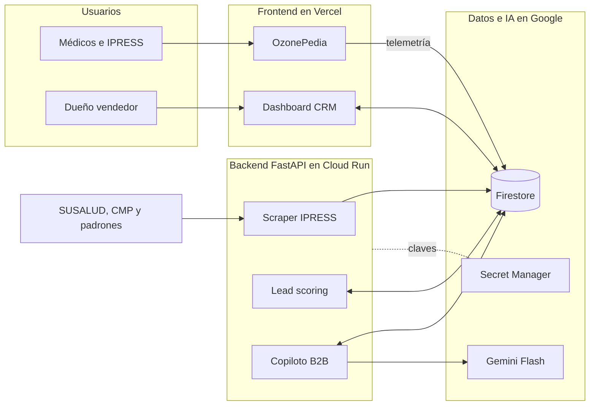

# Ozonoterapia B2B Perú: motor de crecimiento con IA

Documento maestro del proyecto para la IAThon. Reúne en un solo lugar el contexto del negocio, la investigación, las decisiones tomadas, la arquitectura, los requerimientos, los diseños conceptuales, los costos, los riesgos y la hoja de ruta.

> **Estado:** concepto y diseño. No hay código todavía.  
> **Fuentes de este documento:** la conversación de diseño del proyecto, el informe de investigación "Arquitectura de Crecimiento Disruptivo y Modelo de Negocio B2B para Equipos y Capacitación en Ozonoterapia Sistémica en el Mercado Peruano", la presentación para el dueño y los cuatro diseños conceptuales.  
> **Convención:** lo que está entre corchetes, como `[Empresa]` o `[US$ __ / mes]`, es un dato que falta y no se debe inventar.

---

## Índice

1. [Resumen ejecutivo](#1-resumen-ejecutivo)
2. [El problema](#2-el-problema)
3. [Contexto clínico y regulatorio](#3-contexto-clínico-y-regulatorio)
4. [Cliente ideal y comité de compra](#4-cliente-ideal-y-comité-de-compra)
5. [Estrategia: de la investigación a la propuesta de la IAThon](#5-estrategia-de-la-investigación-a-la-propuesta-de-la-iathon)
6. [Decisiones de diseño](#6-decisiones-de-diseño)
7. [Los cuatro motores de la propuesta](#7-los-cuatro-motores-de-la-propuesta)
8. [Arquitectura](#8-arquitectura)
9. [Requerimientos](#9-requerimientos)
10. [Recorrido de un lead](#10-recorrido-de-un-lead)
11. [Diseños conceptuales](#11-diseños-conceptuales)
12. [Qué se puede prototipar rápido y qué se valida antes](#12-qué-se-puede-prototipar-rápido-y-qué-se-valida-antes)
13. [Costos](#13-costos)
14. [Riesgos y mitigaciones](#14-riesgos-y-mitigaciones)
15. [Hoja de ruta y metas](#15-hoja-de-ruta-y-metas)
16. [Narrativa para el jurado](#16-narrativa-para-el-jurado)
17. [Preguntas abiertas](#17-preguntas-abiertas)
18. [Glosario](#18-glosario)
19. [Fuentes](#19-fuentes)

---

## 1. Resumen ejecutivo

Una empresa peruana vende equipos de ozonoterapia sistémica, instalación y capacitación. Hoy depende de una landing page básica y de redes sociales con imágenes genéricas hechas con IA. Solo el dueño vende y le llegan entre 1 y 3 leads serios por semana.

La conclusión del proyecto es que el problema no se resuelve con un chatbot ni con más anuncios. El cliente es institucional (clínicas y médicos especialistas), compra con rigor científico y legal, y necesita confianza antes que velocidad de respuesta.

La propuesta es un **sistema de inteligencia comercial B2B** con cuatro motores:

1. **OzonePedia:** un hub abierto de evidencia y protocolos, en un dominio separado del comercial, que atrae a médicos con información y no con publicidad.
2. **Radar de intención:** la telemetría de lectura del hub convierte visitas en alertas de clínicas interesadas.
3. **Outbound quirúrgico:** un scraper de IPRESS y un copiloto de IA preparan contactos y propuestas personalizadas. El dueño aprueba cada envío.
4. **Posventa en el CRM:** control de insumos, mantenimiento, calibración y capacitación, para sostener ingresos recurrentes.

**Regla central:** la IA trabaja en el back-office y nunca habla con el paciente ni opina sobre dosis o protocolos. Todo borrador generado por IA pasa por aprobación humana.

**Stack:** Vercel, FastAPI en Google Cloud Run, Firebase (Firestore y Auth), Gemini Flash y Google Secret Manager.

---

## 2. El problema

| Situación actual | Consecuencia |
|---|---|
| Marketing inbound pasivo: landing page y redes con pocas impresiones | Solo llegan 1 a 3 leads serios por semana |
| Imágenes genéricas hechas con IA | Proyectan un negocio inexperto ante un comprador médico |
| Un solo vendedor, el dueño | No hay capacidad para prospectar de forma activa |
| Información científica dispersa y percepción de "misterio" | El médico escéptico no encuentra un lugar confiable donde informarse |

**Qué no es el problema:** la velocidad de atención. Un humano atiende 3 leads semanales sin dificultad. El cuello de botella es la cantidad y la calidad de los leads, la confianza del médico y la fricción para cerrar (costo del equipo y miedo regulatorio).

---

## 3. Contexto clínico y regulatorio

Resumen del informe de investigación. Las cifras y normas citadas provienen de ese informe y conviene confirmarlas con el comité médico y con un asesor regulatorio antes de usarlas en material comercial.

**Consenso científico internacional**
- La Declaración de Madrid sobre la Ozonoterapia, emitida por el Comité Científico Internacional de Ozonoterapia (ISCO3), es el documento de referencia.
- Según el informe, define una ventana de concentración segura de 5 a 60 µg/mL y las vías autorizadas, con énfasis en autohemoterapia mayor (AHTm) e insuflaciones. Prohíbe la aplicación endovenosa directa de gas por riesgo de embolia.

**Adopción en Perú**
- El Hospital Rebagliati (EsSalud) realiza más de 300 sesiones mensuales para dolor crónico y patologías musculoesqueléticas.
- La Municipalidad de Lima promueve la terapia como alternativa no quirúrgica para hernias lumbares y afecciones articulares.
- La USIL, con la Clínica Innova Medic, dicta un posgrado en terapias bioxidativas y ozonoterapia. La ASMPO3 organiza congresos y cursos.
- **Escepticismo institucional:** informes del Instituto Nacional de Salud (INS) señalan que parte de la evidencia es escasa o de baja calidad metodológica. Por eso la estrategia debe apoyarse en rigor normativo y evidencia, sin sesgo informal.

**Marco legal (DIGEMID)**
- Los generadores de ozono con fines médicos son dispositivos biomédicos con Registro Sanitario obligatorio, Clase II o III según riesgo (Ley N° 29459 y decretos supremos 016-2011-SA y 016-2013-SA).
- La importación y comercialización se hace a través de droguerías o laboratorios autorizados con Buenas Prácticas de Manufactura (BPM).
- La venta está restringida a IPRESS registradas o a profesionales de la salud colegiados y capacitados.

| Dimensión | Internacional (ISCO3 / UE) | Perú (DIGEMID / MINSA) |
|---|---|---|
| Estatus regulatorio | Normalizado con estándares unificados (Declaración de Madrid, 4.ª edición) | Dispositivo biomédico Clase II/III con Registro Sanitario |
| Canal de venta | B2B a redes hospitalarias y centros de dolor acreditados | Restringido a IPRESS y profesionales colegiados |
| Adopción institucional | Dolor, reumatología, traumatología, oncología complementaria | Sector público (EsSalud) y clínicas privadas de especialidad |
| Percepción | Respaldo de asociaciones médicas y literatura indexada | Aceptado en práctica privada, con reservas metodológicas del INS |

---

## 4. Cliente ideal y comité de compra

El cliente busca una **unidad de servicio clínico llave en mano**, no un generador aislado.

| Segmento | Quién decide | Necesidad | Barrera principal |
|---|---|---|---|
| **Clínicas del dolor y traumatología** (IPRESS I-3 / I-4) | Directores médicos, traumatólogos, anestesiólogos | Alternativas no quirúrgicas para hernias lumbares, artrosis y tendinopatías | Incertidumbre sobre el retorno de inversión y el flujo de pacientes |
| **Medicina regenerativa y longevidad** | Médicos integrativos, especialistas en antienvejecimiento | Terapias sistémicas (AHTm) | Desconfianza en proveedores sin rigor científico o con marketing informal |
| **Médicos especialistas independientes** | Reumatólogos, dermatólogos, médicos del dolor | Diferenciación e ingresos adicionales | Costo inicial del equipo (CapEx) y temor a sanciones de DIGEMID |

**Comité de compra B2B**

| Rol | Evalúa |
|---|---|
| Evaluador clínico (director médico o especialista) | Seguridad del generador, concentración exacta, destrucción de ozono residual, validez académica de la capacitación |
| Evaluador financiero (gerente o administrador) | Costo total de propiedad, retorno de inversión, margen por paciente, costo de insumos |
| Evaluador regulatorio (director técnico) | Vigencia del Registro Sanitario, certificados de calibración, soporte técnico local |

Esto explica el diseño del sistema: una propuesta ROI para el financiero, un dossier regulatorio para el técnico y evidencia abierta para el clínico.

---

## 5. Estrategia: de la investigación a la propuesta de la IAThon

El informe de investigación propone **tres motores de crecimiento** y **tres módulos de IA**. La conversación de diseño los refinó con un criterio lean: construir primero lo que se valida con poco costo y dejar para después lo que exige más esfuerzo o más supervisión médica.

**Motores de crecimiento del informe**

| Motor | Idea | Estado en esta propuesta |
|---|---|---|
| 1. Ozone-as-a-Service (OaaS) | Pasar de venta de equipo (CapEx) a comodato o leasing operativo ligado al consumo mínimo de insumos (OpEx) | **Incluido:** es el modelo de oferta que usan el outbound y el CRM |
| 2. Educación Médica Continua (CME) y alianzas universitarias | Capacitar médicos con ASMPO3 y posgrados; cada médico capacitado es un prospecto calificado | **Parcial:** la OzonePedia cumple el rol educativo digital. Los convenios presenciales quedan para la hoja de ruta |
| 3. Account-Based Growth y Centros de Referencia | Convertir a los mejores clientes en centros de visita y validación entre pares | **Después:** requiere cartera instalada |

**Módulos de IA del informe**

| Módulo | Estado en esta propuesta |
|---|---|
| Provider Intelligence e Intent Engine (scraper de SUSALUD, CMP y padrones, con puntuación y propuesta) | **Incluido** como motor 3 (outbound quirúrgico) |
| Compliance y Protocolization Copilot (carpeta regulatoria, fichas, consentimientos) | **Incluido** como generador de dossier regulatorio, con plantillas estáticas y revisión humana |
| Real-World Evidence Synthesizer (PLN sobre literatura ISCO3 y datos clínicos anonimizados del parque instalado) | **Postergado a la fase 3.** Ver [preguntas abiertas](#17-preguntas-abiertas) |

---

## 6. Decisiones de diseño

| Decisión | Razón |
|---|---|
| **Sin chatbot de WhatsApp de cara al cliente** | Con 1 a 3 leads semanales no hay problema de volumen. Además, un LLM que opine sobre dosis, vías o concentraciones es un riesgo médico y legal (DIGEMID, Colegio Médico) |
| **La IA solo en back-office, con humano en el circuito** | Toda salida de IA es un borrador sujeto a aprobación del dueño antes de salir |
| **OzonePedia en un dominio separado de la landing comercial** | Si la información científica convive con un botón de compra, el médico pierde confianza |
| **OzonePedia administrada a mano al inicio** | Escribir 15 a 20 artículos clave toma un fin de semana. Una IA redactora sería sobreingeniería, requeriría supervisión y arriesga alucinaciones |
| **El outbound es el motor principal desde el día 1** | Esperar a que crezca la cartera mantiene al negocio en 1 a 3 leads. Outbound no significa spam: es prospección dirigida a clínicas con el perfil adecuado |
| **CRM centralizado con módulo de posventa** | El margen recurrente está en insumos, mantenimiento y capacitación, no en la primera venta |
| **Empresa como patrocinador transparente del hub** | Es una práctica común en tecnología médica. Se sostiene con comité médico consultivo y citas a la Declaración de Madrid y a estudios indexados |

---

## 7. Los cuatro motores de la propuesta

| # | Motor | Qué hace | Quién lo opera |
|---|---|---|---|
| 1 | **OzonePedia** | Hub abierto de evidencia y protocolos por especialidad, con buscador, referencias y guías basadas en la Declaración de Madrid | El dueño o un médico colaborador, a mano |
| 2 | **Radar de intención** | Registra qué artículos lee cada visitante, tiempo y búsquedas. Cuando una clínica muestra interés, genera una alerta | Automático |
| 3 | **Outbound quirúrgico** | El scraper detecta IPRESS adecuadas sin ozonoterapia. Gemini redacta contacto personalizado. El dueño aprueba y envía | Automático con aprobación del dueño |
| 4 | **Posventa en el CRM** | Proyecta insumos, agenda calibración/mantenimiento, sugiere notas técnicas | Automático con aprobación del dueño |

---

## 8. Arquitectura

### Vista de componentes

---

## 9. Requerimientos del Sistema

### Funcionales
- **RF-01 Alojamiento y despliegue:** Interfaz pública alojada en Vercel.
- **RF-02 Conocimiento clínico estructurado:** Contenido jerárquico por especialidad en OzonePedia.
- **RF-03 Dashboard de Pipeline Comercial Outbound:** Interfaz tipo Kanban/Tabla servida en Vercel para flujo de ventas B2B (*Descubierto, Contactado, Propuesta Enviada, Cierre/Contrato Firmado*).
- **RF-04 Módulo de Posventa y Retención:** Panel para seguimiento del parque instalado, proyección de insumos (kits AHTm, líneas sin PVC, frascos de vacío) y alertas de mantenimiento preventivo y calibración DIGEMID.
- **RF-05 Interfaz de Aprobación del Copiloto (Human-in-the-Loop):** Pantalla para que el dueño apruebe con 1 clic borradores Outbound, propuestas ROI y Dossiers generados por IA antes del envío.
- **RF-06 Scraping e ingesta de IPRESS:** Servicio backend para cruce de padrones.
- **RF-07 Scoring de IPRESS:** Algoritmo de puntuación por perfil y telemetría.
- **RF-08 Generador de dossier regulatorio y ROI:** Plantillas estructuradas sin alucinación.

### No funcionales
- **RNF-01 Cifrado en tránsito y reposo:** HTTPS TLS 1.3 y Cloud KMS.
- **RNF-02 Gestión de secretos:** Secret Manager, credenciales fuera del cliente.
- **RNF-03 Cumplimiento regulatorio:** Ley 29733 (Datos Personales) y normas DIGEMID (Dispositivos Clase II/III).
- **RNF-04 Rendimiento y Carga Rápida:** LCP inferior a 1.5 segundos en la interfaz del CRM.
