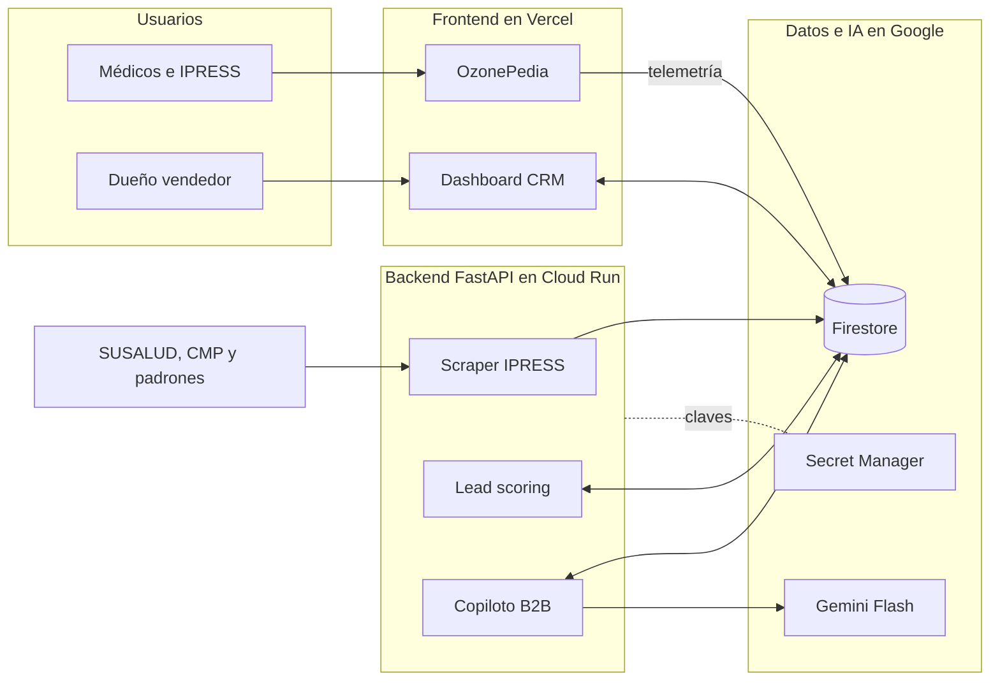

# Ozonoterapia B2B Perú: motor de crecimiento con IA

Documento maestro del proyecto para la IAThon. Reúne en un solo lugar el contexto del negocio, la investigación, las decisiones tomadas, la arquitectura, los requerimientos, los diseños conceptuales, los costos, los riesgos y la hoja de ruta.

> **Estado:** prototipo CRM funcional con conexión preparada para Firebase Authentication y Firestore.
> **Fuentes de este documento:** la conversación de diseño del proyecto, el informe de investigación "Arquitectura de Crecimiento Disruptivo y Modelo de Negocio B2B para Equipos y Capacitación en Ozonoterapia Sistémica en el Mercado Peruano", la presentación para el dueño y los cuatro diseños conceptuales.
> **Convención:** lo que está entre corchetes, como `[Empresa]` o `[US$ __ / mes]`, es un dato que falta y no se debe inventar.

### Puesta en marcha local

1. Instala dependencias con `npm install`.
2. Crea `.env.local` a partir de `.env.example` y completa la configuración pública de Firebase.
3. En Firebase Authentication, habilita el proveedor Google.
4. Crea manualmente el primer documento `users/{uid}` con `role: "admin"`.
5. Publica las reglas con `firebase login` y `firebase deploy --only firestore:rules`.
6. Ejecuta `npm run dev` y entra a la aplicación con la cuenta autorizada.

La app lee `prospects` desde Firestore y conserva los mocks como fallback cuando Firebase está deshabilitado o no contiene datos. Las credenciales locales están excluidas por `.gitignore`.

### Generación de borradores con IA

El backend FastAPI desplegado en Cloud Run expone `/generate/outbound`, `/generate/roi` y `/generate/dossier`. El frontend obtiene el Firebase ID token de la sesión actual y lo envía como `Authorization: Bearer ...`; no se usa una API key de Gemini en el navegador.

Desde el panel lateral de un prospecto:

1. Pulsa **Generar outbound con IA**, o regenera ROI/dossier cuando existan parámetros previamente validados.
2. El resultado se guarda en `proposals` con estado `pending_approval`.
3. Revisa el contenido en el modal de **Aprobación humana**.
4. Solo al pulsar aprobar se guarda como `approved` y se actualiza el prospecto.

Si el backend no responde, la interfaz muestra el error y no crea un borrador falso. Los campos regulatorios del dossier se envían desde los datos validados existentes y nunca se completan automáticamente.

---

## Índice

1. [Resumen ejecutivo](#1-resumen-ejecutivo)
2. [El problema](#2-el-problema)
3. [Contexto clínico y regulatorio](#3-contexto-clínico-y-regulatorio)
4. [Cliente ideal y comité de compra](#4-cliente-ideal-y-comité-de-compra)
5. [Estrategia: de la investigación a la propuesta de la IAThon](#5-estrategia-de-la-investigación-a-la-propuesta-de-la-iathon)
6. [Decisiones de diseño](#6-decisiones-de-diseño)
7. [Los cuatro motores de la propuesta](#7-los-cuatro-motores-de-la-propuesta)
8. [Arquitectura](#8-arquitectura)
9. [Requerimientos](#9-requerimientos)
10. [Recorrido de un lead](#10-recorrido-de-un-lead)
11. [Diseños conceptuales](#11-diseños-conceptuales)
12. [Qué se puede prototipar rápido y qué se valida antes](#12-qué-se-puede-prototipar-rápido-y-qué-se-valida-antes)
13. [Costos](#13-costos)
14. [Riesgos y mitigaciones](#14-riesgos-y-mitigaciones)
15. [Hoja de ruta y metas](#15-hoja-de-ruta-y-metas)
16. [Narrativa para el jurado](#16-narrativa-para-el-jurado)
17. [Preguntas abiertas](#17-preguntas-abiertas)
18. [Glosario](#18-glosario)
19. [Fuentes](#19-fuentes)

---

## 1. Resumen ejecutivo

Una empresa peruana vende equipos de ozonoterapia sistémica, instalación y capacitación. Hoy depende de una landing page básica y de redes sociales con imágenes genéricas hechas con IA. Solo el dueño vende y le llegan entre 1 y 3 leads serios por semana.

La conclusión del proyecto es que el problema no se resuelve con un chatbot ni con más anuncios. El cliente es institucional (clínicas y médicos especialistas), compra con rigor científico y legal, y necesita confianza antes que velocidad de respuesta.

La propuesta es un **sistema de inteligencia comercial B2B** con cuatro motores:

1. **OzonePedia:** un hub abierto de evidencia y protocolos, en un dominio separado del comercial, que atrae a médicos con información y no con publicidad.
2. **Radar de intención:** la telemetría de lectura del hub convierte visitas en alertas de clínicas interesadas.
3. **Outbound quirúrgico:** un scraper de IPRESS y un copiloto de IA preparan contactos y propuestas personalizadas. El dueño aprueba cada envío.
4. **Posventa en el CRM:** control de insumos, mantenimiento, calibración y capacitación, para sostener ingresos recurrentes.

**Regla central:** la IA trabaja en el back-office y nunca habla con el paciente ni opina sobre dosis o protocolos. Todo borrador generado por IA pasa por aprobación humana.

**Stack:** Vercel, FastAPI en Google Cloud Run, Firebase (Firestore y Auth), Gemini Flash y Google Secret Manager.

---

## 2. El problema

| Situación actual | Consecuencia |
|---|---|
| Marketing inbound pasivo: landing page y redes con pocas impresiones | Solo llegan 1 a 3 leads serios por semana |
| Imágenes genéricas hechas con IA | Proyectan un negocio inexperto ante un comprador médico |
| Un solo vendedor, el dueño | No hay capacidad para prospectar de forma activa |
| Información científica dispersa y percepción de "misterio" | El médico escéptico no encuentra un lugar confiable donde informarse |

**Qué no es el problema:** la velocidad de atención. Un humano atiende 3 leads semanales sin dificultad. El cuello de botella es la cantidad y la calidad de los leads, la confianza del médico y la fricción para cerrar (costo del equipo y miedo regulatorio).

---

## 3. Contexto clínico y regulatorio

Resumen del informe de investigación. Las cifras y normas citadas provienen de ese informe y conviene confirmarlas con el comité médico y con un asesor regulatorio antes de usarlas en material comercial.

**Consenso científico internacional**
- La Declaración de Madrid sobre la Ozonoterapia, emitida por el Comité Científico Internacional de Ozonoterapia (ISCO3), es el documento de referencia.
- Según el informe, define una ventana de concentración segura de 5 a 60 µg/mL y las vías autorizadas, con énfasis en autohemoterapia mayor (AHTm) e insuflaciones. Prohíbe la aplicación endovenosa directa de gas por riesgo de embolia.

**Adopción en Perú**
- El Hospital Rebagliati (EsSalud) realiza más de 300 sesiones mensuales para dolor crónico y patologías musculoesqueléticas.
- La Municipalidad de Lima promueve la terapia como alternativa no quirúrgica para hernias lumbares y afecciones articulares.
- La USIL, con la Clínica Innova Medic, dicta un posgrado en terapias bioxidativas y ozonoterapia. La ASMPO3 organiza congresos y cursos.
- **Escepticismo institucional:** informes del Instituto Nacional de Salud (INS) señalan que parte de la evidencia es escasa o de baja calidad metodológica. Por eso la estrategia debe apoyarse en rigor normativo y evidencia, sin sesgo informal.

**Marco legal (DIGEMID)**
- Los generadores de ozono con fines médicos son dispositivos biomédicos con Registro Sanitario obligatorio, Clase II o III según riesgo (Ley N° 29459 y decretos supremos 016-2011-SA y 016-2013-SA).
- La importación y comercialización se hace a través de droguerías o laboratorios autorizados con Buenas Prácticas de Manufactura (BPM).
- La venta está restringida a IPRESS registradas o a profesionales de la salud colegiados y capacitados.

| Dimensión | Internacional (ISCO3 / UE) | Perú (DIGEMID / MINSA) |
|---|---|---|
| Estatus regulatorio | Normalizado con estándares unificados (Declaración de Madrid, 4.ª edición) | Dispositivo biomédico Clase II/III con Registro Sanitario |
| Canal de venta | B2B a redes hospitalarias y centros de dolor acreditados | Restringido a IPRESS y profesionales colegiados |
| Adopción institucional | Dolor, reumatología, traumatología, oncología complementaria | Sector público (EsSalud) y clínicas privadas de especialidad |
| Percepción | Respaldo de asociaciones médicas y literatura indexada | Aceptado en práctica privada, con reservas metodológicas del INS |

---

## 4. Cliente ideal y comité de compra

El cliente busca una **unidad de servicio clínico llave en mano**, no un generador aislado.

| Segmento | Quién decide | Necesidad | Barrera principal |
|---|---|---|---|
| **Clínicas del dolor y traumatología** (IPRESS I-3 / I-4) | Directores médicos, traumatólogos, anestesiólogos | Alternativas no quirúrgicas para hernias lumbares, artrosis y tendinopatías | Incertidumbre sobre el retorno de inversión y el flujo de pacientes |
| **Medicina regenerativa y longevidad** | Médicos integrativos, especialistas en antienvejecimiento | Terapias sistémicas (AHTm) | Desconfianza en proveedores sin rigor científico o con marketing informal |
| **Médicos especialistas independientes** | Reumatólogos, dermatólogos, médicos del dolor | Diferenciación e ingresos adicionales | Costo inicial del equipo (CapEx) y temor a sanciones de DIGEMID |

**Comité de compra B2B**

| Rol | Evalúa |
|---|---|
| Evaluador clínico (director médico o especialista) | Seguridad del generador, concentración exacta, destrucción de ozono residual, validez académica de la capacitación |
| Evaluador financiero (gerente o administrador) | Costo total de propiedad, retorno de inversión, margen por paciente, costo de insumos |
| Evaluador regulatorio (director técnico) | Vigencia del Registro Sanitario, certificados de calibración, soporte técnico local |

Esto explica el diseño del sistema: una propuesta ROI para el financiero, un dossier regulatorio para el técnico y evidencia abierta para el clínico.

---

## 5. Estrategia: de la investigación a la propuesta de la IAThon

El informe de investigación propone **tres motores de crecimiento** y **tres módulos de IA**. La conversación de diseño los refinó con un criterio lean: construir primero lo que se valida con poco costo y dejar para después lo que exige más esfuerzo o más supervisión médica.

**Motores de crecimiento del informe**

| Motor | Idea | Estado en esta propuesta |
|---|---|---|
| 1. Ozone-as-a-Service (OaaS) | Pasar de venta de equipo (CapEx) a comodato o leasing operativo ligado al consumo mínimo de insumos (OpEx) | **Incluido:** es el modelo de oferta que usan el outbound y el CRM |
| 2. Educación Médica Continua (CME) y alianzas universitarias | Capacitar médicos con ASMPO3 y posgrados; cada médico capacitado es un prospecto calificado | **Parcial:** la OzonePedia cumple el rol educativo digital. Los convenios presenciales quedan para la hoja de ruta |
| 3. Account-Based Growth y Centros de Referencia | Convertir a los mejores clientes en centros de visita y validación entre pares | **Después:** requiere cartera instalada |

**Módulos de IA del informe**

| Módulo | Estado en esta propuesta |
|---|---|
| Provider Intelligence e Intent Engine (scraper de SUSALUD, CMP y padrones, con puntuación y propuesta) | **Incluido** como motor 3 (outbound quirúrgico) |
| Compliance y Protocolization Copilot (carpeta regulatoria, fichas, consentimientos) | **Incluido** como generador de dossier regulatorio, con plantillas estáticas y revisión humana |
| Real-World Evidence Synthesizer (PLN sobre literatura ISCO3 y datos clínicos anonimizados del parque instalado) | **Postergado a la fase 3.** Ver [preguntas abiertas](#17-preguntas-abiertas) |

**Qué se agregó en la conversación y no estaba en el informe:** la OzonePedia como hub abierto de atracción, la telemetría de lectura como radar de intención y el módulo de posventa dentro del CRM.

---

## 6. Decisiones de diseño

| Decisión | Razón |
|---|---|
| **Sin chatbot de WhatsApp de cara al cliente** | Con 1 a 3 leads semanales no hay problema de volumen. Además, un LLM que opine sobre dosis, vías o concentraciones es un riesgo médico y legal (DIGEMID, Colegio Médico) |
| **La IA solo en back-office, con humano en el circuito** | Toda salida de IA es un borrador sujeto a aprobación del dueño antes de salir |
| **OzonePedia en un dominio separado de la landing comercial** | Si la información científica convive con un botón de compra, el médico pierde confianza |
| **OzonePedia administrada a mano al inicio** | Escribir 15 a 20 artículos clave toma un fin de semana. Una IA redactora sería sobreingeniería, requeriría supervisión y arriesga alucinaciones |
| **El outbound es el motor principal desde el día 1** | Esperar a que crezca la cartera mantiene al negocio en 1 a 3 leads. Outbound no significa spam: es prospección dirigida a clínicas con el perfil adecuado |
| **CRM centralizado con módulo de posventa** | El margen recurrente está en insumos, mantenimiento y capacitación, no en la primera venta |
| **Empresa como patrocinador transparente del hub** | Es una práctica común en tecnología médica. Se sostiene con comité médico consultivo y citas a la Declaración de Madrid y a estudios indexados |

**Nota sobre la existencia de una wiki abierta:** durante la investigación de apoyo se concluyó que no existe una wiki abierta y en español de ozonoterapia orientada a la práctica clínica. La biblioteca de ISCO3 sería de acceso restringido. Conviene verificarlo antes de usarlo como argumento ante el jurado.

---

## 7. Los cuatro motores de la propuesta

| # | Motor | Qué hace | Quién lo opera |
|---|---|---|---|
| 1 | **OzonePedia** | Hub abierto de evidencia y protocolos por especialidad (traumatología, medicina del dolor, dermatología, odontología), con buscador, referencias en formato Vancouver o APA y guías basadas en la Declaración de Madrid | El dueño o un médico colaborador, a mano |
| 2 | **Radar de intención** | Registra qué artículos lee cada visitante, cuánto tiempo y qué busca. Cuando una clínica muestra interés, genera una alerta | Automático |
| 3 | **Outbound quirúrgico** | El scraper detecta IPRESS con perfil adecuado y sin ozonoterapia. Gemini redacta un contacto personalizado para el director médico. El dueño aprueba y envía | Automático con aprobación del dueño |
| 4 | **Posventa en el CRM** | Proyecta el consumo de insumos, agenda mantenimiento y calibración, y sugiere notas técnicas cuando la OzonePedia publica algo relevante | Automático con aprobación del dueño |

**Retroalimentación entre motores:** el outbound lleva al médico a la OzonePedia para validar el sustento. La telemetría avisa al dueño cuándo llamar. El resultado vuelve al CRM.

---

## 8. Arquitectura

### Vista de componentes



### Capas

| Capa | Tecnología | Responsabilidad |
|---|---|---|
| Cliente | Navegador | Médicos leen la OzonePedia. El dueño usa el CRM |
| Frontend | Vercel (Next.js) | OzonePedia con SEO y buscador. Dashboard CRM con Kanban, alertas y posventa |
| Backend | FastAPI en Google Cloud Run | Scraper de IPRESS, lead scoring, copiloto de propuestas y dossier |
| Datos | Firebase Firestore y Auth | Pipeline de leads, telemetría, equipos instalados, consumo, mantenimiento, borradores |
| IA | Gemini Flash | Borradores en JSON estricto con plantillas. Nunca contacto directo con el cliente |
| Secretos | Google Secret Manager | Claves de API y credenciales fuera del código |

### Seguridad
- Cifrado en tránsito con HTTPS y TLS 1.3 entre todas las capas.
- Cifrado en reposo en Firestore, gestionado por Google Cloud KMS.
- Claves y credenciales solo en Secret Manager o variables de entorno del servidor, nunca en el cliente.
- Roles en Firebase Auth: solo el administrador (el dueño) lee y escribe el CRM y los leads.
- Cumplimiento de la Ley N° 29733 de Protección de Datos Personales.

### Estructura de repositorio sugerida (propuesta, sin validar)

```
/apps/hub        OzonePedia (Next.js, MDX)
/apps/crm        Dashboard del dueño (Next.js)
/services/api    FastAPI: scraper, scoring, copiloto
/docs            Este README, presentación y diseños
```

---

## 9. Requerimientos

Versión actualizada con seguridad y outbound.

### Funcionales

**Módulo 1. Inbound y hub de conocimiento (OzonePedia)**
- **RF-01 Alojamiento y despliegue:** la interfaz pública se aloja en Vercel, con alta velocidad, disponibilidad global y SEO.
- **RF-02 Conocimiento clínico estructurado:** contenido jerárquico por especialidad, con guías basadas en la Declaración de Madrid y referencias.
- **RF-03 Telemetría de lectura e intención:** captura de artículos leídos, tiempo de permanencia y términos buscados, con sincronización asíncrona a Firestore.

**Módulo 2. Prospección activa (outbound quirúrgico)**
- **RF-04 Scraping e ingesta de IPRESS:** servicio FastAPI en Cloud Run que extrae y cruza periódicamente SUSALUD, Colegio Médico del Perú y padrones municipales.
- **RF-05 Scoring de IPRESS:** puntaje según infraestructura, especialidades y comportamiento en la OzonePedia.
- **RF-06 Borrador de contacto con Gemini Flash:** mensajes personalizados para directores médicos por correo o LinkedIn, centrados en el modelo OaaS.

**Módulo 3. CRM centralizado y copiloto B2B**
- **RF-07 Pipeline comercial en Firestore:** estado de cada lead en tiempo real, del descubrimiento a la firma.
- **RF-08 Generador de dossier regulatorio y ROI:** informes de costo-beneficio y carpeta técnica compatible con DIGEMID (fichas técnicas, certificados, consentimientos).
- **RF-09 Validación humana:** toda propuesta o documento generado por IA es un borrador que el dueño aprueba antes de enviarlo.

**Módulo 4. Posventa, mantenimiento y retención**
- **RF-10 Control y proyección de consumibles:** consumo estimado de kits AHTm, líneas sin PVC y frascos de vacío, con alertas de reabastecimiento.
- **RF-11 Mantenimiento y calibración:** agenda y seguimiento de calibración y mantenimiento preventivo de los equipos instalados.

### No funcionales
- **RNF-01 Cifrado en tránsito:** HTTPS y TLS 1.3 entre frontend, backend, base de datos y API de Gemini.
- **RNF-02 Cifrado en reposo:** activo en Firestore mediante Cloud KMS.
- **RNF-03 Gestión de secretos:** claves de Gemini, credenciales de servicio y tokens de Firebase fuera del código y del cliente.
- **RNF-04 Cumplimiento regulatorio:** Ley N° 29733 para datos personales y estándares de seguridad acordes con la gestión de dispositivos Clase II/III ante DIGEMID.
- **RNF-05 Baja latencia:** LCP del hub inferior a 1,5 segundos.
- **RNF-06 Autoescalado:** backend sin estado en Cloud Run, para soportar picos del scraper y de generación con IA.

---

## 10. Recorrido de un lead

```
Detecta ──> Redacta ──> Aprueba ──> Investiga ──> Cierra
scraper     Gemini      dueño       médico lee    CRM alerta,
encuentra   prepara     revisa y    la            dueño llama con
una IPRESS  borrador    envía       OzonePedia    propuesta ROI y
                                                  dossier
```

| Paso | Actor | Resultado |
|---|---|---|
| 1. Detecta | Scraper | Una IPRESS con perfil adecuado y sin ozonoterapia |
| 2. Redacta | Gemini Flash | Borrador personalizado para el director médico |
| 3. Aprueba | Dueño | Revisa y envía. Nada sale sin su validación |
| 4. Investiga | Médico | Lee la OzonePedia. La telemetría lo registra |
| 5. Cierra | CRM y dueño | Alerta, propuesta ROI, dossier regulatorio y llamada de cierre |

**Variante inbound:** un médico llega a la OzonePedia por su cuenta. Si su lectura sugiere intención, el CRM crea o actualiza el prospecto y genera la alerta.

---

## 11. Diseños conceptuales

Cuatro pantallas de ejemplo, con la misma identidad visual que la presentación. Los nombres, puntajes y cifras de las pantallas del CRM son **datos de ejemplo**. Los datos médicos de la wiki están como marcadores entre corchetes y los debe definir el comité médico.

| # | Pantalla | Qué muestra |
|---|---|---|
| 1 | **OzonePedia (wiki)** | Portada con buscador, árbol de especialidades, artículo de ejemplo con tabla de protocolo y referencias, comité editorial y acceso discreto al sitio comercial |
| 2 | **CRM, pipeline B2B** | Tablero con Descubierto, Contactado, Propuesta enviada y Cierre. Tarjetas con puntaje y borrador de IA por aprobar |
| 3 | **CRM con alerta proactiva** | Campana con contador, aviso, tarjeta resaltada y panel lateral con la actividad en la OzonePedia, la sugerencia de la IA y las acciones |
| 4 | **Módulo de posventa** | Consumo de insumos con estados, sugerencia de recordatorio, calendario de mantenimiento y calibración, y avance de capacitación |

La presentación para el dueño (11 láminas) cubre contexto, decisiones, motores, arquitectura, recorrido del lead, impacto, costos, beneficios, riesgos y hoja de ruta.

---

## 12. Qué se puede prototipar rápido y qué se valida antes

| Componente | ¿Se puede prototipar rápido? | Qué validar antes |
|---|---|---|
| Frontend OzonePedia (Vercel) | Sí | Elegir una buena plantilla de documentación o MDX |
| Dashboard CRM (Next.js y Tailwind) | Sí, en gran parte | Diseñar el flujo de estados de la venta B2B |
| Telemetría básica | Sí | Definir aviso y consentimiento (ver riesgos) |
| Scraper de SUSALUD y CMP (FastAPI) | No | Probar selectores HTML, captchas, bloqueos de IP y límites de uso. Verificar si los datos públicos traen contacto del director médico |
| Prompts y dossiers (Gemini Flash) | No | Probar salida estructurada en JSON y aplicar plantillas estrictas. El texto regulatorio va pre-redactado y la IA solo rellena variables |
| Seguridad y cifrado (Firebase y GCP) | No | Reglas de lectura y escritura de Firestore, roles en Auth, secretos fuera del código |

**Guardarraíl anti-alucinación:** Gemini no redacta libremente especificaciones técnicas ni normativas. Rellena variables (nombre de la clínica, ROI calculado, nombre del médico) sobre plantillas fijas. Un número de Registro Sanitario o un precio inventado destruiría la credibilidad del dueño.

---

## 13. Costos

Estimaciones de la investigación de apoyo. Las que no tienen respaldo propio están marcadas.

| Componente | Costo | Nota |
|---|---|---|
| Hub de prueba (Notion o GitBook) | US$ 0 / mes | Valida el primer mes |
| Hub con marca propia | ~US$ 4–6 / mes | Hosting básico (S/ 15–25) y Wiki.js, BookStack o MediaWiki, que son gratuitos |
| Dominio .pe o .com | ~US$ 12 / año | Aproximadamente S/ 110 |
| Backend, base de datos e IA | `[US$ __ / mes]` | **Por medir con el prototipo.** El volumen es bajo (1 a 3 leads semanales) |
| Contenido inicial | Tiempo del equipo | 15 a 20 artículos, un fin de semana |

**Comparación:** hub completo con marca propia, menos de US$ 10 al mes, frente a un gasto actual estimado de US$ 100–300 al mes en diseños con IA y anuncios. **Este último dato es una estimación sin confirmar con el dueño.**

---

## 14. Riesgos y mitigaciones

| Riesgo | Mitigación |
|---|---|
| Alucinaciones del LLM en documentos o propuestas | IA solo en back-office, JSON estricto con Pydantic, plantillas estáticas para texto regulatorio y aprobación humana |
| Scraping bloqueado o incompleto | Prueba previa con las fuentes reales. Cruzar con LinkedIn o Google Maps si faltan contactos |
| Exposición de datos de clínicas, contactos y propuestas | Cifrado en tránsito y reposo, Secret Manager, roles en Auth y reglas de Firestore, Ley 29733 |
| Desconfianza por conflicto de interés en el hub | Dominio separado, comité médico consultivo, empresa como patrocinador visible, citas de la Declaración de Madrid |
| **Telemetría que identifica visitantes por IP o huella digital** | Definir aviso de privacidad y consentimiento antes de vincular lecturas a una clínica o persona. Este punto no estaba resuelto en el diseño original |
| Escepticismo institucional (INS) | Contenido con evidencia citada y comité médico. No prometer eficacia sin respaldo |
| Incumplimiento regulatorio en la venta | Vender solo a IPRESS o profesionales colegiados, con Registro Sanitario vigente. Dossier regulatorio revisado por el dueño |

---

## 15. Hoja de ruta y metas

### A. Piloto en tres fases (propuesta de la IAThon)

| Fase | Contenido |
|---|---|
| **Fase 1: IAThon** | OzonePedia con 15 a 20 artículos, CRM Kanban del dueño y demo del flujo (scraper, borrador y alerta) |
| **Fase 2: Validación** | Probar el scraper con SUSALUD y CMP, afinar scoring y plantillas del copiloto, medir lecturas del hub y primeros contactos |
| **Fase 3: Escala** | Módulo de posventa completo, más especialidades y capacitaciones, automatizar el hub solo si la demanda lo justifica |

### B. Hoja de ruta comercial a seis meses (informe de investigación)

| Fase | Hito | Indicador | Meta del informe |
|---|---|---|---|
| **Meses 1–2** Reestructuración de la oferta | Homologar el expediente DIGEMID, estructurar contratos OaaS, dejar los canales informales, firmar convenios marco (ASMPO3 o centros de formación) | Cumplimiento normativo y contratos OaaS redactados | 100 % de cumplimiento legal |
| **Meses 3–4** Despliegue de motores B2B y piloto de IA | Prospección asistida por IA sobre 200 clínicas priorizadas en Lima, talleres clínicos presenciales, programa de Centros de Referencia | Leads B2B calificados por semana | 10 a 15 leads institucionales por semana |
| | Seminarios de capacitación práctica | Conversión de médicos capacitados a contratos de colocación | Más de 25 % de adopción |
| **Meses 5–6** Aceleración y escala nacional | Expansión a Arequipa, La Libertad, Lambayeque y Cusco, red de Centros de Referencia | Equipos en operación con contrato recurrente | 15 a 20 unidades activas |
| | Reportes de Evidencia en el Mundo Real | Whitepapers locales | 5 reportes por especialidad |

> **Importante:** las metas de la tabla B vienen del informe de investigación y **no están validadas con el dueño**. Se tratan como hipótesis hasta medir el piloto. La presentación evita prometer cifras de conversión por la misma razón.

---

## 16. Narrativa para el jurado

1. **Entendimos el negocio real.** Con 1 a 3 leads semanales, un chatbot es un absurdo operativo. Lo descartamos y lo explicamos.
2. **Entendimos el riesgo.** En salud, un LLM de cara al cliente es un riesgo legal y médico. La IA va detrás de escena y el humano valida.
3. **Atracción sin parecer vendedor.** Un hub abierto de evidencia, en dominio separado, construye autoridad ante un comprador escéptico.
4. **La IA donde mueve la aguja.** Prospección, propuesta ROI y dossier regulatorio, que son las tres fricciones reales de la venta.
5. **Lean y viable.** El hub se administra a mano, cuesta menos de US$ 10 al mes y la inversión grande queda condicionada a validar la demanda.
6. **Ciclo de vida completo.** Atracción, prospección, conversión, posventa y retención, con ingresos recurrentes.

---

## 17. Preguntas abiertas

| Tema | Pregunta |
|---|---|
| Empresa | ¿Cuál es el nombre real de la empresa y el dominio para el hub y para el sitio comercial? |
| Datos públicos | ¿SUSALUD, CMP y padrones traen el contacto del director médico o administrador, o solo el nombre de la clínica? |
| Costos | ¿Cuánto cuestan en la práctica backend, Firestore y Gemini Flash? ¿Cuánto gasta hoy el dueño en diseños y anuncios? |
| Comité médico | ¿Qué médicos integran el comité consultivo que revisa el contenido de la OzonePedia? |
| Metas | ¿Se adoptan las metas del informe (10–15 leads por semana, más de 25 % de conversión, 15–20 equipos) o se definen otras tras el piloto? |
| Evidencia del mundo real | El informe propone un sintetizador de RWE y un asistente que responda a la fuerza de ventas consultas de dosificación con referencias. Esto choca con la decisión de no dejar a un LLM opinar sobre protocolos. ¿Se acepta solo con revisión humana y en la fase 3? |
| Telemetría | ¿Cómo se informa y se obtiene consentimiento para vincular lecturas con una clínica? |
| Normativa | ¿Un asesor regulatorio puede confirmar las referencias normativas del informe antes de usarlas en material comercial? |
| Wiki existente | ¿Se verifica que no exista ya una wiki abierta de ozonoterapia en español antes de afirmarlo ante el jurado? |

---

## 18. Glosario

| Término | Significado |
|---|---|
| **AHTm** | Autohemoterapia mayor |
| **ABG** | Account-Based Growth, crecimiento basado en cuentas |
| **BPM** | Buenas Prácticas de Manufactura |
| **CapEx / OpEx** | Gasto de capital / gasto operativo |
| **CME** | Educación Médica Continua |
| **CMP** | Colegio Médico del Perú |
| **CRM** | Sistema de gestión de relación con clientes |
| **DIGEMID** | Dirección General de Medicamentos, Insumos y Drogas (Autoridad Nacional de Productos Farmacéuticos, Dispositivos Médicos y Productos Sanitarios) |
| **ICP** | Perfil de cliente ideal |
| **INS** | Instituto Nacional de Salud |
| **IPRESS** | Institución Prestadora de Servicios de Salud |
| **ISCO3** | Comité Científico Internacional de Ozonoterapia |
| **KOL** | Líder de opinión clave |
| **LCP** | Largest Contentful Paint, métrica de velocidad de carga |
| **OaaS** | Ozone-as-a-Service, modelo de servicio con equipo en comodato y consumo mínimo de insumos |
| **ROI** | Retorno de inversión |
| **RWE** | Evidencia en el mundo real |
| **SUSALUD** | Superintendencia Nacional de Salud |
| **TCO** | Costo total de propiedad |
| **Human-in-the-loop** | Una persona valida cada salida de la IA antes de que salga |

---

## 19. Fuentes

Obras citadas en el informe de investigación. Las fuentes 16, 17, 21, 22 y 28 son literatura general de marketing y estrategia MedTech, no fuentes clínicas ni normativas.

**Evidencia y consenso científico**
1. 4th Edition of the Madrid Declaration on Ozone Therapy, ISCO3: https://isco3.org/6356-2/
2. Madrid Declaration on Ozone Therapy (Scribd): https://www.scribd.com/document/926140787/MADRID-DECLARATION-ON-OZONE-THERAPY
3. Madrid Declaration on Ozone Therapy, 2nd edition, ISCO3: https://isco3.org/madrid-declaration-2nd-edition/
9. Uso de ozonoterapia en salud, repositorio INS: https://repositorio.ins.gob.pe/items/f87838ce-5ad8-4c75-bef9-4a4f0d5fd62d
26. Revisión: ozonoterapia como alternativa médica (Dialnet): https://dialnet.unirioja.es/descarga/articulo/9743857.pdf

**Adopción y formación en Perú**
4. Hospital Rebagliati de EsSalud, más de 300 sesiones mensuales: https://www.gob.pe/institucion/essalud/noticias/911986-hospital-rebagliati-de-essalud-realiza-mas-de-300-sesiones-mensuales-de-ozonoterapia-para-controlar-dolor-en-pacientes
5. Ozonoterapia contra el dolor por hernia lumbar, Municipalidad de Lima: https://www.gob.pe/institucion/munilima/noticias/312065-ozonoterapia-una-alternativa-para-reducir-el-dolor-por-hernia-lumbar-y-enfermedades-articulares
6. Terapia Bioxidativa y Ozonoterapia, USIL: https://usil.edu.pe/posgrado/educacion-ejecutiva/salud/terapia-bioxidativa-y-ozonoterapia/
7. Congreso de Ozonoterapia en Perú: https://aepromo.org/congreso-de-ozonoterapia-se-realizo-exitosamente-en-peru/
8. XXVI Curso de Ozonoterapia, ASMPO3: https://www.asmpo3.com/
15. Colegio Médico del Perú: https://cmp.org.pe/
18. Cómo se hace una sesión de ozonoterapia sistémica, Clinalgia: https://clinalgia.com/como-se-hace-una-sesion-de-ozonoterapia-sistemica-clinalgia-responde/
19. Ozonoterapia, Terapia Celular del Perú: https://terapiacelularperu.com/servicios/ozonoterapia/
20. Ozonoterapia, IntegraMédica Perú: https://www.integramedica.pe/ozonoterapia/
23. Ozonoterapia: qué es, beneficios, contraindicaciones, Peruozono: https://www.peruozono.com/ozonoterapia-que-es-beneficios-contraindicaciones/
24. Medicina Regenerativa y Ozonoterapia, Clínica Chacarilla: https://www.chacarilla.com.pe/medicina-regenerativa-y-ozonoterapia/
25. Servicios y tratamientos, Instituto de Ozonoterapia en Lima: https://www.peruozono.com/servicios-y-tratamientos/
27. Ozonoterapia: qué es y beneficios, Oncosalud: https://blog.oncosalud.pe/ozonoterapia

**Regulación**
10. Qué equipos médicos requieren registro DIGEMID en Perú: https://equiposmedicoperu.com/blog-equipos-medicos-requieren-registro-digemid-peru.html
11. Dispositivos Médicos, DIGEMID: https://www.digemid.minsa.gob.pe/webDigemid/registro-sanitario/dispositivos-medicos/
12. ABC de la regulación de dispositivos médicos en Perú: https://www.prcp.com.pe/documentos/Sobre-el-ABC-de-la-regulacio%CC%81n-de-Dispositivos-Me%CC%81dicos-en-Peru%CC%81-.pdf
13. Certificado de registro sanitario para productos farmacéuticos y dispositivos médicos: https://www.gob.pe/22978-certificado-de-registro-sanitario-para-productos-farmaceuticos-y-dispositivos-medicos
14. Listado de dispositivos médicos para comercializar, DIGEMID: https://www.digemid.minsa.gob.pe/Archivos/Normatividad/2021/LISTADO_DISPOSITIVOS_COMERCIALIZACION.pdf
29. Registro Sanitario de Dispositivos Médicos, DIGEMID: https://www.digemid.minsa.gob.pe/rsDispositivos/

**Estrategia MedTech B2B**
16. MedTech, definición y ejemplos B2B, SalesHive: https://saleshive.com/glossary/medtech
17. The Rise of the Next Generation of Medtech "Milkmen", BCG: https://www.bcg.com/publications/2021/six-design-strategies-for-medical-technology-next-generation-commercial-model
21. B2B Healthcare Marketing Agency, The Growth Syndicate: https://www.thegrowthsyndicate.com/industries/b2b-healthcare-marketing-agency
22. Capturing value from customer-centric medtech services, McKinsey: https://www.mckinsey.com/industries/life-sciences/our-insights/capturing-value-from-customer-centric-medtech-services
28. Medtech trends 2026, ZS: https://www.zs.com/insights/medtech-trends-2026-industry-strategy-and-execution

**Fuentes consultadas en la conversación de diseño**
- Biblioteca de ISCO3 (ISCO3 Library)
- Medical News Today, ozone therapy: usos, beneficios y efectos secundarios
- Herramientas de wiki y documentación gratuitas (Notion, GitBook, Wiki.js, BookStack, MediaWiki)
